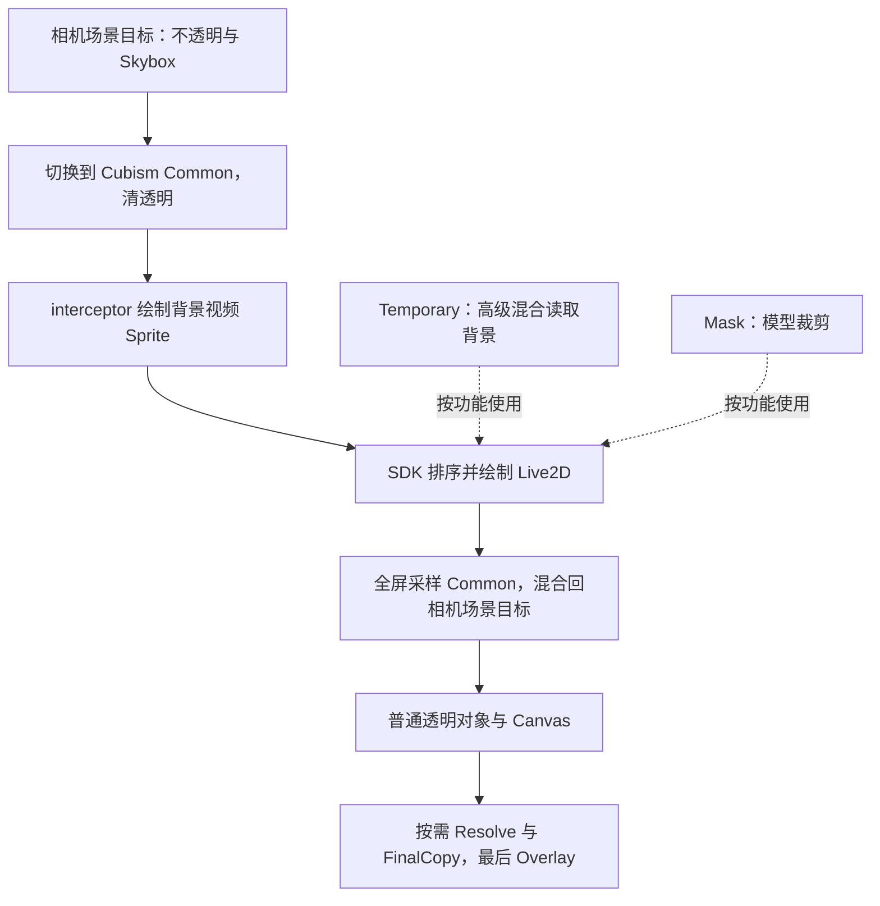
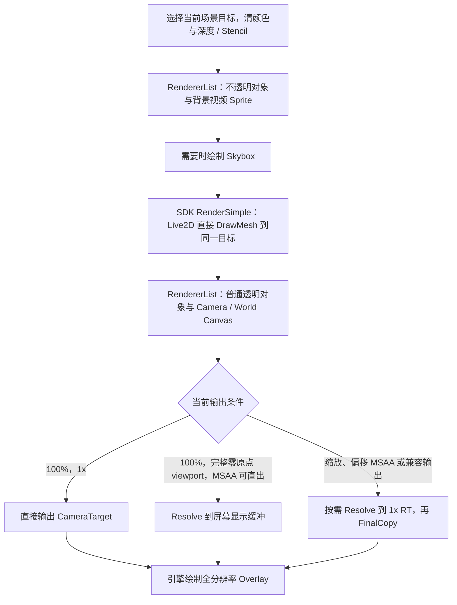

> 2026-10-18 最新菜单可见性：普通档位仅显示画质、帧率、桌面垂直同步和图形兼容模式；两种分辨率缩放与全部实时调试信息只在自定义且非兼容模式显示。兼容模式保留帧率、桌面 VSync 和兼容开关。自定义中，系统缩放不支持的平台仍显示「不支持」并拒绝调节。以下旧记录中普通档可见的描述已被本条替代。本轮设置回归 1212 项断言通过，未运行主游戏或真机。

> 2026-10-18 增补：帧率 / 桌面 VSync 已迁至 Rendering 常规区，兼容模式保留；旧 Display 键按字段迁移，新值优先。普通预设即可查看路径、系统缩放读回状态及实际显示 / 场景尺寸。Windows / Editor / iOS 保留系统缩放行，显示「不支持」并拒绝调节。尺寸以成功主屏提交和附件回退结果为准，系统缩放状态不等于 GPU 正确性或全显示链免拷贝。最新验证见 README 的「实时尺寸诊断与帧率设置」。

> 2026-10-18 当前：自定义渲染精度 10%～200%；系统分辨率缩放为独立 10%～100% 数值（均步长 5%），默认 100%，保存到 JSON，Android Player 生效。两项独立相乘，兼容模式临时恢复系统缓冲。固定 75% 节能实验为历史。Android Blit Type 已改 Auto（2）；Vulkan 忽略该设置。实际显示、输入、功耗待真机验证。

# MRP 渲染架构与优化审计

初次审计：2026-10-16；未提交代码全面复审：2026-10-17。适用版本：Unity 6000.3.17f1；代码基线为当前工作区（Git HEAD `99694753` 加未提交修改），不能只用该提交还原本文实现。

MRP（MajRenderPipeline）是为 MajdataPlay 当前 2D 内容定制的无光照渲染管线。它使用 Unity 的 SRP、相机剔除和 RendererList，集中控制绘制顺序、场景分辨率及颜色 / 深度附件的生命周期。优化重点是减少无用离屏合成、全屏读写和附件保存，在相同画质与帧率下降低移动端负担。

2026-10-16 的审计与用户反馈确认当时视频和 Live2D 正常，提供的游玩 Frame Debugger 捕获未见明显异常；它不能证明模型界面、长屏偏移或移动端功耗。随后手机测试报告 MSAA、兼容 Copy 与不同 RenderScale 的位置不一致，2026-10-17 前一轮据此调整输出坐标映射及偏移 MSAA 路径，本轮进一步取消 ScreenPosCameraMover 的自动 viewport 上移，详见第 4 节；各轮验证分列于第 8 节，没有本次手机实屏通过结论，不沿用早期“未发现阻断项”的结论。

## 1. Frame Debugger 截图说明

截图连接的是 **Editor**，当前停在 **Event #24 Draw Mesh**。预览仅包含执行到该事件为止的内容；检查最终完整画面应选最后一个事件。

| 截图内容 | 判断 |
| --- | --- |
| `MajRenderPipeline.RenderCamera 52`，内部绘制分支 51 | 表示事件计数，不是 52 ms，也不是 52 张 RT 或 52 次全屏合成。 |
| `GameView RT`，1080×1920，`R8G8B8A8_UNorm` | 所选事件写入 Editor 的 GameView 输出。Editor 的 CameraTarget 本来就可以是纹理，不能因为名称有 RT 就认定 MRP 又增加了一张中间颜色。 |
| `Maj/UI/Circle Mask`、`SRPDEFAULTUNLIT`、4 顶点 / 6 索引 | 一个正常的 UI 四边形。SrcAlpha / OneMinusSrcAlpha、ZWrite Off 与透明 UI 用途相符。 |
| 颜色 `Store`、`Memoryless No` | 最终颜色需要保存供显示。这里不是在查看独立的深度或 MSAA 颜色附件，不能据此判断移动端 memoryless 失效。 |
| 两组 Canvas 绘制 9 / 31，另有 Dynamic 与 Instanced 事件 | 表明当前绘制主要包含 UI 与场景几何；不能单凭事件数量判断瓶颈。Instanced 只证明对应几次绘制使用了实例化。 |
| `Draw Dynamic` | 六个 MRP 预设均关闭普通 Mesh 的 CPU Dynamic Batching；该名称也可来自引擎动态几何通路，需要选中事件看对象与网格，不能反推开关失效。 |
| `<unknown scope>` 中的 Clear / Draw GL、`Unnamed command buffer`、`Batch cause: Unknown reason` | 这些标签本身不是错误。前两项 Clear / GL 位于 MRP scope 之外，截图不足以确定其来源；CommandBuffer 未命名也不代表多执行了一遍。 |

可见主分支没有额外的 Cubism Common / Temporary / Mask 合成或 FinalCopy，符合当前 **100% + 1x 直接输出**的预期；实际 MSAA 样本数未在截图中显示，不能仅凭这张图判定开关。

这张捕获看起来属于 Game 游玩界面。`Game.unity` 没有小小蓝白模型引用，`GamePlayManager` 进入游玩时还会隐藏全局背景视频。因此，它能检查游玩输出，模型路径则应在 List / Result / Practice 等实际显示模型的界面捕获。当前视频、模型正常的视觉结论来自用户反馈与此前隔离验证。

Unity 的 [Frame Debugger 说明](https://docs.unity3d.com/6000.3/Documentation/Manual/FrameDebugger-debug.html)将它定位为逐事件检查工具；事件列表不提供连续运行的帧率或功耗。动态几何与普通 Mesh 动态合批也应分开理解，见 [Unity 动态合批说明](https://docs.unity3d.com/cn/2022.3/Manual/dynamic-batching.html)。

### 截图之后补充的诊断名称

截图记录的是命名前状态。当前 CommandBuffer 已命名 `MRP.RenderCamera`，原生 Pass 提供 `MRP.Scene` / `MRP.FinalCopy` 名称；Editor / Development 还有 `MRP.Opaque`、`MRP.Skybox`、`MRP.CameraExtension`（当前 Live2D）、`MRP.Transparent`、`MRP.FinalCopy` 分组。11 个原本没有 Name 的项目 Shader Pass 也已补齐，包括截图中的 CircleMask。

原先跨 Execute 的外层采样已删除，局部阶段标记在同次执行内配对；Release 不记录细分采样命令。这些更改只增加诊断名称，未新增 RT 或绘制。Unity 的内置事件名、未知拆批原因以及 MRP scope 外的未知事件不受这些接口控制，原生 Pass 名的实际显示也取决于工具与后端。改名后的 Frame Debugger 层级仍需重新捕获确认。

Windows 游玩 BGA 的现有外部视频纹理和输出 RT 另标注为 `Maj VLC Video Frame` / `Maj Video BGA`；仍沿用原 Graphics.Blit，名称不改变视频复制方式。

## 2. MRP 负责什么

MRP 支持当前游戏需要的无光照 Sprite、Mesh、Canvas、背景视频材质和普通 Live2D 绘制，不实现 Lit、灯光、阴影、HDR 后处理或可采样的 Opaque / Depth Texture。深度 / Stencil **附件仍然存在**，用于正常遮挡和 UI 遮罩；“不生成 Depth Texture”不等于“没有深度缓冲”。

当前仍使用 Unity 原生 RendererList 的剔除、SortingLayer、CanvasOrder、透明排序和传统 GPU Instancing。MRP 没有重写显卡驱动、视频解码、对象池、音符更新或游戏判定时间源，也不是“全游戏只剩一个 Unlit Shader”：UI、音符、Live2D、TMP 各自的着色逻辑继续保留。

| 模块 | 当前职责 |
| --- | --- |
| `Runtime/MajRenderPipelineAsset.cs` | RenderScale、MSAA、附件优化、Resolve、Batcher / Instancing 配置。 |
| `Runtime/MajRenderPipeline.cs` | 相机排序与回调、全局状态接管和恢复；Overlay UI 留给引擎最后绘制一次。 |
| `Runtime/MajCameraRenderer.cs` | 剔除、绘制顺序、相机路径选择、Shader globals、按需 FinalCopy。 |
| `Runtime/MajCameraAttachments.cs` | 复用 RT，设置 Clear / Store / Resolve / DontCare，检查实际 MSAA 与 memoryless 回退。 |
| `Runtime/MajRenderScale.cs`、`Runtime/MajFinalCopyMapping.cs` | 场景比例与取整；物理输出尺寸、逻辑输出矩形及 FinalCopy 的裁剪空间映射。 |
| `Library/`、`Runtime/Shaders/` | 本地无光照 HLSL 库、MRP Unlit 与 FinalCopy。 |
| `Editor/` | Scene View / Gizmos 兼容和材质编辑；Player 用条件编译排除编辑器代码。 |
| `Assets/Live2D/Cubism/Rendering/MRP/` | 调用 SDK 的简单绘制；依赖方向为桥接 → SDK 与 MRP，MRP 本体不依赖 SDK。 |

管线继续返回 `UniversalPipeline` Shader 标签以兼容旧材质。它只是匹配 SubShader 的字符串，不会启动 URP，也不构成 URP 包依赖。

## 3. 原来的路径与开销来源

### URP 本身的配置

旧 Renderer 资产使用 `m_UseNativeRenderPass: 0`、`m_IntermediateTextureMode: 1`，偏向保守的中间颜色路径。旧 URP 的 HDR、Depth / Opaque Texture、主灯和附加灯已经关闭，不能把本轮收益解释成“终于关掉了一直在算的灯光和阴影”。资产配置也不能单独证明每一帧究竟执行了多少拷贝。

MRP 的主要改变，是围绕本项目实际输出需求明确管理附件，省掉可省的中间目标与保存。移除 URP 及其 Shader 依赖另有构建与维护价值，但包体积、编译时间、CPU 调度和 GPU 带宽是不同指标。

### Cubism 的通用离屏合成

旧 SDK URP Pass，以及最初移植到 MRP 的完整桥接，都准备 Common、Temporary、Mask 三张工作颜色纹理。早期 MRP 在尺寸 / 格式 / 样本数不变时复用它们，并非每帧重新 `new` 三张。

旧背景业务会在特定场景关闭普通背景 SpriteRenderer，再让 Cubism interceptor 在模型合成过程中手动画背景：

小小蓝白的 64 个部件全部是 Normal / Over，原生模型检查为 0 遮罩、0 Offscreen。因此，旧路径真正额外执行的是 **Common 的清空、背景 / 模型写入和全屏合成**；Temporary / Mask 虽被准备，却没有对应功能需要。不能说每帧减少了“三张 RT 的全部读写”。

背景 interceptor 只是画 Sprite，并不需要读取相机已有颜色，但早期桥接的 `hasActiveInterceptor` 仍会强制进入中间合成。这让一个排序需求同时带来了离屏层、目标切换和全屏混合，还使原生附件优化无法完整发挥作用。

**原设计意图推测：**统一的离屏层便于 SDK 支持高级混合、部件遮罩、Offscreen 分组及跨模型排序；高级混合确实存在先复制已有结果到 Temporary、再采样背景的分支。背景也接入同一排序框架，可能是为了稳定视频与模型的前后关系。这个推断与 [Live2D 自定义 Render Pass 的资源及流程说明](https://docs.live2d.com/en/cubism-sdk-manual/rendering-urp/)相符，但不代表已经确认原作者的决策动机。通用设计有其用途，只是超出了当前模型和场景的需要。

## 4. 当前绘制路径

Init 背景 VideoPlayer 使用 **MaterialOverride**，`targetTexture` 为空；它给现有 SpriteRenderer 提供视频纹理。背景保留 BG 排序层、order -32768 和 Queue 2000 的不透明材质，在当前场景的不透明阶段绘制。视频底层的解码 / 显示纹理仍然需要，它与删除的 Cubism Common 不是一回事；其他业务视频也不能据此一概认定没有 RT。

游玩 BGA 是另一条视频业务：Windows 的 `BGManager` 用一张与视频同尺寸的 ARGB32 RT 接收 VLC 外部纹理，新视频帧到达时 Graphics.Blit，再交给 RawImage；非 Windows 的 Game 场景 VideoPlayer 绑定 720×720、1x、无深度 / mip 的 `UnityVideoPlayer.renderTexture`。这两条按平台选择，实际更新取决于谱面是否播放视频；它们并未随 Cubism 简化删除。Windows 的 Graphics.Blit 位于 MRP 之外，可能产生 Draw GL 事件，但本次未捕获其与截图 unknown scope 的逐项对应。

2026-10-17 全面复审修复了独立的视频生命周期问题：旧实现重建或销毁时没有显式释放旧 RT / 外部纹理包装；BottomRight 旋转交换宽高后，下一帧仍与未旋转的视频尺寸比较，可能反复重建。现在分开记录视频源尺寸，只释放本组件创建的 RT 与 Unity 外部纹理包装，不销毁 LibVLC 拥有的原生纹理，也不释放序列化的视频 RT 资产。LibVLC 的 Media getter 会创建新的 retained wrapper，原判空 / Dispose 与解析中的重复 getter 可能遗留引用；现在为每次请求创建同一个受控 local，直接解析它，并用 using 释放，播放器独立保留其 native reference。图片 / 视频切换恢复相应 Renderer 和模式状态；请求版本与销毁标记阻止已取消的异步准备续体覆盖新的选择。视频时间源、Seek / Rate 和每个新视频帧一次 Blit 的规则保持不变。

MRP 的 Live2D 桥接现在只有当前模型需要的简单路径：剔除前暂时禁止 SDK MeshRenderer 自动绘制，随后用 SDK 内部顺序和真正的 DrawMaterial 手动 DrawMesh，在 `finally` 恢复原 `forceRenderingOff`。占位 Picking 材质不能直接当最终材质交给普通 RendererList。

`RequiresIntermediateTarget` 恒为 false，桥接没有 Common / Temporary / Mask 字段、创建、切换、复制或释放逻辑，`RenderSimple` 也不进入完整 SDK 的 RT 池和合成资源初始化。背景控制器的 interceptor 字段、场景通知与专用枚举标记已删除。SDK 中完整高级功能源码仍保留，**当前 MRP 不接入，也没有准备高级回退**；以后更换带遮罩或高级混合的模型，需要重新适配。

普通 RendererList 内保持原生排序，Live2D 部件之间保持 SDK 排序；当前整组模型固定在不透明之后、普通透明之前。这满足现有背景 / 模型 / UI 关系，不提供任意透明对象与模型部件交错排序。

### 不同分辨率与 MSAA 的附件

下表是符合优化资格、开启 Optimize Attachments 的主相机路径：

| 条件 | MRP 场景颜色附件 | 结束方式 |
| --- | --- | --- |
| 100% + 1x | 直接 CameraTarget，没有中间颜色 RT | Store 显示颜色，无 FinalCopy。 |
| 100% + MSAA，完整零原点 viewport 且可直接输出 | MSAA 颜色附件，没有单采样中间颜色 | Resolve 到屏幕显示缓冲，无 FinalCopy。 |
| 小于 100% + 1x | 一张较小的单采样场景颜色 RT | FinalCopy 放大到输出。 |
| MSAA + 缩放、viewport 偏移，或不能直接 Resolve | MSAA 颜色 + 一张单采样颜色 RT | Resolve 后 FinalCopy 拷贝 / 缩放；符合资格时仍使用原生 memoryless 附件。 |

以上各条原生场景路径还保留一张深度 / Stencil 附件。100% / 1x 省掉的是中间颜色，不是所有 RT；场景附件之外，Editor 的 GameView 输出和视频底层解码纹理仍存在，当前 Live2D 不再单独创建工作 RT。memoryless 表示附件可不占用普通外存后备，不等于没有附件对象。

原生 Pass 只 Resolve MSAA 颜色，不额外 Store 多采样内容；深度 / Stencil 保留到透明 UI 完成，Pass 结束才 DontCare。设备支持时，深度请求 memoryless Depth，多采样颜色请求 memoryless MSAA，单采样 Resolve 结果保持可读取。MSAA 颜色创建失败或返回的格式、样本数、memoryless 标记不符时，以相同画质重试普通颜色附件并缓存拒绝结果。深度没有独立的普通附件重试；深度或整体附件准备失败时退回相机兼容绘制，此时不再保证资产请求的缩放与 MSAA。有关术语见 Unity 的 [Resolve](https://docs.unity3d.com/6000.3/Documentation/ScriptReference/Rendering.RenderBufferStoreAction.Resolve.html)与 [memoryless 模式](https://docs.unity3d.com/6000.3/Documentation/ScriptReference/RenderTextureMemoryless.html)。

直接屏幕 Resolve 要求 **Vulkan 或 iOS Player 的 Metal、Gamma、100%、独立 Game 相机、完整零原点 viewport**，且相机逻辑输出与物理屏幕尺寸一致；还必须满足系统多采样缓冲能力、无额外 backbuffer blit / sRGB blit、无 HDR 等条件。非零 x/y 偏移的 MSAA 不尝试屏幕直接 Resolve，保留原生场景 Pass 与支持时的 memoryless MSAA / 深度，改为 Resolve → 1x RT → FinalCopy。Linear、GLES3、D3D11 等不满足筛选的情况也保留 Copy。本机 Windows D3D11 / Editor 回退是历史验证；代码没有额外排除 Windows / Editor 的 Vulkan，不能泛化到所有桌面后端。D3D11 曾实际触发 backbuffer 多采样附件不支持并出现重影，因此兼容路径中的 FinalCopy 是必要成本；其他 Vulkan 环境仍需各自验证。

场景缩放只用于安全独立、完整清屏的主显示器 Game 相机。相机 `pixelWidth / pixelHeight` 是逻辑输出尺寸，场景附件按它乘 RenderScale；主屏 Pass 使用实际显示缓冲尺寸：Android Player 取有效的 `Display.renderingWidth / renderingHeight`，其它平台沿用 `Screen.width / Screen.height`，两者不能混用。Android 主屏 viewport 由归一化 Camera.rect 映射一次，不假定 camera.pixelRect 是否已被引擎缩放。原生附件要求归一化 rect 宽高均为 1，且逻辑与物理尺寸一致。ScreenPosCameraMover 已取消按长宽比自动设置 y=.12 / .22，初始化使用 (0,0,1,1) 完整 viewport。长屏不再仅因屏幕比例被强制 Copy；100% 且满足后端等条件时，MSAA 可以直接 Resolve 到屏幕。默认构图不再自动上移，保留手动 MainScreenScale / MainScreenOffset 及原保存值；手动项改变相机 Transform / 正交 Size 和 Canvas 布局，不改变 rect，也不是 RenderScale，不会单独破坏完整 viewport 直出资格。RenderScale 非 100% 仍需 RT + Copy。

Editor 的长宽屏预览还需与桌面窗口配置区分：`GameManager.ApplyScreenConfig` 现仅在桌面 Player 应用保存的全屏与分辨率，Editor 由 Game View / Device Simulator 决定尺寸，仍保留 FPS 设置。此前 Editor 也执行桌面分支，会把 1080×1920 渲染图铺到其它比例的模拟设备上，形成纵向或横向拉伸；本次只修正条件编译，没有调整 MRP 投影、附件、MSAA 或 Canvas。用户重新进入 Play 后反馈恢复，隔离 ScreenSimulation / DeviceView 尺寸与网格观测支持该原因；验证边界见第 8 节。

长屏还需要让世界相机与 UI 使用相同像素比例：Canvas Expand 按 `min(W/1080,H/1920)` 缩放，而固定 Size 9.6 的世界相机按屏高缩放，曾在 1080×2400 上产生分区大 25%、中心上移 135 像素。当前 ScreenPosCameraMover 在完整 rect 下按相同 Expand 比例适配运行时正交范围，并补偿相机 Y 保持主屏底部锚点；9:16 序列化基线 9.6 / Y4.2 和既有手动参数含义保留。触摸通过同一 Camera 逆投影，传感器世界查表与半径不修改；这项逻辑不读取 MRP 场景 RT 或 RenderScale。详见 [长屏相机与传感器对齐](../README.md#2026-10-17-长屏相机与传感器对齐)。

MRP 继续为其它调用者设置的非原点 rect 保留兼容兜底：100% / 1x 按原 pixelRect 直绘；偏移 MSAA、缩放或兼容输出先画到本地场景附件，再 Copy。偏移 MSAA 仍可保留符合条件的原生 Resolve-only 和 memoryless，不以关闭整个原生路径处理。

FinalCopy 的实际 viewport 固定为整张物理输出的零原点矩形；新 `MajFinalCopyMapping` 纯函数将逻辑 pixelRect 换算为 Shader 裁剪空间 scale / bias，Y 平移仅乘 `GL.GetGPUProjectionMatrix(Matrix4x4.identity, false).m11` 的符号。原 Game 源 UV 保持不变，targetTexture / Scene View 保留原纹理方向转换；不把 GPU 方向修正再次写入相机矩阵。Fragment 用局部 UV 的 0～1 域裁剪源矩形，整附件清屏保证未覆盖区域没有旧帧或 Clamp 拉边；不将完整图像压缩到屏幕交集。场景 RT 内不添加矩形平移，避免重复偏移和底部内容漏画。

宽或高不为 1、逻辑与物理尺寸不一致等情况保留兼容附件路径；targetTexture、Scene View、同屏多相机、XR、动态分辨率保留各自边界，不能当作完整 URP 功能等价替换。Editor Gizmos 可能要求保留附件。关闭附件优化不关闭请求的 MSAA；有缩放 / MSAA 或明确要求兼容输出时使用普通附件与 FinalCopy，100% / 1x 的默认直接输出保留原 CameraTarget 绘制。

第 8 节分开记录此前全屏布局调整的 8 个程序集编译与 739 项 stub 控制流检查，以及更早手机偏移修复的源码 / 离屏 GPU 结果；该布局阶段没有重跑此前 GPU 矩阵，当前纹理采样 bias / 单一 Quality 改动也不能沿用它们作为重新通过。手机实际 CameraTarget / Display / Present 及功耗尚无当前通过结论。此前 Pad 5 Pro 的 Resolve / Canvas / Mask 矩阵使用旧版完整 viewport。此前长屏 60 次 D3D11 GPU 绘制又以显式 RT 代屏幕、手动给定 viewport 并使用纹理 Copy 方向，没有覆盖 Android 实际相机逻辑尺寸与物理 Screen 的关系、屏幕原始 UV 或 backbuffer viewport 的 Y 解释；不能将它们沿用为本次手机验证。此次处理的是已发现的坐标空间风险，不据此认定 SoC 缺失 MSAA 功能，也未证实 Unity / 驱动内部的唯一根因。

## 5. 已完成的优化

| 优化 | 实际减少或改变的工作 | 收益范围 |
| --- | --- | --- |
| 移除 Cubism 中间合成 | 不再准备三张工作 RT；删除 Common 清空、全屏采样合成和中途目标切换 | 对实际显示视频 / 模型的界面直接减少工作；不等于合并了 64 个模型部件的 DrawCall。 |
| 按需场景颜色 | 100% / 1x 直绘；完整零原点 viewport 支持时 100% / MSAA 直接 Resolve | 缩放、偏移 MSAA 和兼容后端仍有必要颜色 RT；偏移时保留支持的 memoryless 优势。 |
| 附件 Load / Store 优化 | 可丢弃的深度 / Stencil 不跨 Pass 保存；MSAA 只 Resolve，支持时 memoryless | 为移动 GPU 减少外存往返提供条件，实际带宽取决于后端与硬件。 |
| RenderScale | 支持降低场景分辨率或最高 150% 超采样；保留取整和相应滤波 | 50% 宽高对应 25% 像素，75% 对应 56.25%；总成本还包括输出复制、几何与全分辨率 Overlay。 |
| Android ASTC 4×4 | 压缩两张 Live2D 主图及 EffectAtlas，保留已有尺寸与 mip 策略 | 历史导入结果约 11.67 MiB，同尺寸 / mip RGBA32 约 46.67 MiB；这是存储比较，不是逐帧带宽降幅。 |
| 本地 Shader 库与 URP 解耦 | 项目及 Cubism 的相关 Shader 不再 include URP / Core 包路径；移除游戏端硬引用与旧 Feature | 降低包和升级耦合；去 include 或改名本身不保证 ALU 减少。 |
| 有选择的 half | 有界颜色中间值降低精度；位置、矩阵、UV、时间、边缘和缓冲布局保留 | 部分移动后端可能受益；fixed → half 的等价清理不计额外收益，不改变纹理 / RT 格式。 |
| 关闭各向异性 | 唯一 Default 档使用 Disable；管线维持约束，退出时恢复接管前状态 | 符合当前正交 2D 用途；原来究竟产生多少额外采样未测。 |
| 独立纹理质量采样 bias | 低 / 中 / 高在已接入自动 LOD 采样中分别叠加 +2 / +1 / 0，不再通过资源 mip limit 切档 | 可改变采样精度与缓存压力，不减少高 mip 驻留容量，带宽 / 功耗收益待同条件测量。 |
| 复用与状态管理 | 复用 CommandBuffer、RT、描述数组、Material 和能力查询，缓存失败；异常后恢复模型与全局状态 | 减少配置稳定时的重复准备；不声称整个游戏零 GC。 |

原迁移阶段的 23 个项目 Shader 统一 `Maj/...` 命名并使用 HLSLPROGRAM，属性、材质接口与 GUID 保留；Live2D / TMP 自有名称保留。`UnityPerDraw` 等引擎 ABI 字段不能因为本项目没有灯光就随意删减。

没有实施全局禁用 Mipmap。两张 Live2D 主图仍有 mip，EffectAtlas 不生成 mip。当前 `QualitySettings.globalTextureMipmapLimit` 固定为 0，空 Groups 继续表示没有分组例外；纹理质量改用独立 `_MajTextureMipBias` 调整已接入 Shader 的自动 LOD 采样。现代本地采样宏保留原 RenderScale 的 `_GlobalMipBias` 补偿后叠加质量偏移，原先没有比例补偿的 legacy 采样只加质量偏移；不更改 `Texture.mipMapBias`，也不再次限制纹理加载等级。

质量采样 bias 不删除或禁止上传高分辨率 mip，因而不减少这部分纹理驻留容量；高档 0 仍按纹理投影大小正常选 mip。只有 mip 链和接入 Shader 同时存在时才有预期精度差异。普通 Bilinear 只在所选单层 mip 内过滤，不在相邻 mip 之间连续插值；Trilinear 才执行级间混合，本轮未批量改变纹理导入过滤设置。移除 mip 可以减少完整链的存储，但不能据此推导固定节约 1/3 采样带宽；MSAA 也不替代纹理缩小时的滤波。

项目相关自定义自动 LOD、Live2D 主图和 TMP_Sprite 图像采样接入这项全局值；全部 TMP SDF 和未发现资源引用的三份 TMP Bitmap Shader 保留。共享宏中使用的视频 / Composite RT 等若只有一层 mip，带 bias 的采样最终仍落在 LOD 0；FinalCopy 文件及其采样不改。外部纹理是否生成 mip、是否走上述 Shader，以及其它内置 / 第三方 Shader 的覆盖，应按实际绘制链逐项确认，不能宣称所有纹理都同样生效。以上是当前实现边界，本轮编译、逻辑和设备结果仍需单独登记；此前测试不自动成为本轮验证。

当前主业务场景 / Prefab 的默认 UI 与游戏 SpriteRenderer 入口已改用共享 `Maj/UI/Default` / `Maj/Sprites/Default`；RuntimeDatabase 普通音符的默认材质入口一并替换，使用这一入口的外部皮肤也随最终材质采样，但没有 mip 时仍不会产生质量档差异。资源静态迁移为 91 份文件、1568 处引用，保留 Sprite、fileID 与 meta。unused 场景、未配置的历史 Prefab 和任意外部自带 Shader 不因此宣称全覆盖；静态引用结果不等于运行中所有绘制已验证。

### 为什么减少全屏操作值得做

1080×1920 的 RGBA8 图像逻辑大小约 7.91 MiB。一次完整读取再写入约 15.82 MiB，按 120 次 / 秒折算约 1.99 GB/s 的逻辑像素数据量；透明混合还可能读取目标颜色。

这只是理解数量级的例子。缓存、tile 驻留、压缩、覆盖区域与硬件 Resolve 都会改变实际外存流量，不能把这个数字作为已测得或固定节省的带宽。删除不需要的 Common 全屏合成，比仅把它的 Shader 变量改成 half 更直接地减少了工作。

## 6. 当前质量配置与依赖

2026-10-17 起游戏使用独立渲染设定，位于显示与音量之间。Unity Quality 当前只有 Default（索引 0）：完整保留原 Low block 的其它参数及 MRP_Low 引用，各平台默认为 0；Graphics 的 MRP_Low 绑定不变。六份 MRP 预设及 GUID 仍保留，其余五份不再注册为 Unity Quality 档位。游戏以 Default 为引擎基线，通过非序列化覆盖设置下列参数，不改写预设资产。

| 游戏画质 | 场景比例 | MSAA 请求 | 纹理质量采样 bias | 输出偏好 |
| --- | --- | --- | --- | --- |
| 节能 | 100% | 关闭 | +1 | 直接输出 |
| 性能 | 100% | 关闭 | 0 | 直接输出 |
| 美观 | 100% | 4x | 0 | 直接输出 |
| 精致 | 150% | 4x | 0 | RT + Copy |

普通档位只显示画质与兼容开关。渲染质量行连续十次 8 号键 / A8 区点击进入并立即保存自定义，保留原参数；下次读取自定义会显示细项，选择普通预设则重新隐藏。1 号键 / A1 的原校准入口不变。自定义包含 50%–150%、步长 5% 的分辨率，非 100% 强制 RT + Copy，返回 100% 后允许手动选择直接输出。

兼容模式临时覆盖为 50% / MSAA 关闭 / 质量采样 bias +2 / RT + Copy，只保留兼容开关可见，关闭后恢复原设置。自定义纹理低 / 中 / 高分别为 +2 / +1 / 0。Global Mipmap Limit 保持 0，不将这些数值解释为 Quarter / Half 资源加载分辨率。直接输出仍受后端与相机资格约束；超采样不能直接 Resolve 到尺寸不同的屏幕，需要缩小复制。实际附件样本数仍由设备选择，不能将 8x 请求视为实际 8x。

旧配置的 Display 画质 / 比例迁入 Rendering，无法精确匹配新档位的保留为自定义；新分类已存在时优先读取新分类。新用户默认性能 / 100%，桌面 VSync 保留独立显示选项。详细运行时覆盖及本次编译 / 逻辑测试范围见 [README](../README.md#游戏设置与运行时覆盖)。

早期 Pad 6S Pro 的 Medium / High 对照、随后 Pad 5 Pro 的屏幕句柄修复属于此前版本证据，详见 [Android MSAA 调查](Android-MSAA-Compatibility.md)。本次新增动态设置及 150% 路径未重新做主游戏或真机回归，不沿用旧测试结果。

URP 已从 manifest / lock 移除，MRP 主程序集不引用 URP / Core RP / Live2D。ShaderGraph 17.3.0 仍间接保留 Core RP 17.3.0，不能称整个工程已无 Core 包。SDK 可选 URP 适配源码由包版本条件停编；SDK 目录和命名空间中出现 URP 字样，也不等于当前 MRP 正在执行它。

闲置 `Addctive.mat` 仍保留旧 URP Particles/Lit 的未解析 Shader 引用，未启用样例、隐藏旧预设及部分 Graph 也有历史资源。这些未发现进入当前主游戏绘制链；它们属于后续资源清理，不是这帧新增 Lit 绘制的证据。材质主体与 GUID 按此前要求保留。

### 2026-10-18 节能显示缓冲实验

仅 Android Player 的节能档在面板原生宽高上请求 75% rendering buffer；表中的场景比例仍为该缓冲上的 100%，不额外缩成 56.25% 的宽高。MSAA / 纹理 bias 与节能原参数一致，场景正常直绘时不新增 MRP FinalCopy。其它档位与兼容模式请求恢复首次接管前的 rendering 尺寸，保留快速来回切档的同一恢复基准；方向变化按当前方向排列宽高，启动期无有效缓冲则延期捕获。异步切换的短暂旧尺寸不作为已稳定的 75% / 100% 结果。

实际附件、viewport、Copy 和 Shader 尺寸参数按 Display 的实际读回统一；CPU Camera / Canvas / 触摸不写补偿比例。等比布局数值不变不是原生输入正确性的证明，尤其 touch.radius 及 Android Overlay 需要实测。当前 `androidBlitType:0` 对应 Always，Unity 在 MRP 外仍可能执行 offscreen→framebuffer 呈现复制；本轮未改此设置。读取 Direct 路径仅能确认 MRP 分支，不能代表整个链路无 RT / Copy 或功耗已经降低。

实现和日志说明见 [README 实验说明](../README.md#2026-10-18-android-节能显示缓冲-75实验)。没有修改 settings.json 格式、菜单、共享相机 / Canvas 资产、输入判定或视频时钟。该项是供新 Android 包观察的实验，未沿用 2026-10-17 的 GPU / 设备结果作为本轮通过。

## 7. 审计结论与后续重点

### 2026-10-17 未提交代码全面复审

本轮先记录 346 个变更 / 新增 / 删除路径，再检查现存 35 份 C#、56 份 Shader / include、程序集和包配置，以及场景 / Prefab / 材质引用链；已删除源码同时检查调用与 GUID 去向。这里包含未跟踪的新 MRP、桥接和设置源码，不能用 tracked diff 的行数代替范围。字体、图片二进制和资源更新清单保留已有修改，本轮不重新生成、不宣称做过逐像素美术验收。

复审覆盖目标与异常恢复、Resolve / Copy 条件、尺寸 / 质量切换、Live2D 简单直绘和排序缓存、设置迁移 / 高级入口、相机与传感器坐标、视频所有权，以及 Shader 精度 / 裁切 / mip 规则。确认并修复的背景视频问题见第 4 节。Break 的四处图集 UV 修复已获用户“好了”的反馈；本轮没有再次运行该手机画面，不能据此扩展为全部 Shader、机型或功耗通过。

另外修复两个已有接口边界：`CircleMask` 原来有 AlphaClip 属性和条件分支，却没有关键字变体；`RoundedRect` 的 shader_feature 又可能剥离运行时由 UGUI 启用的变体。两者改为 local multi_compile，默认分支、属性和材质保留。当前保存材质没有启用这项，不能将它解释成已发生的截图故障。设置的 A8 连按入口则补齐 A1 / A4 / A5 按下时即时中断，避免延迟的 ClickCompleted 通知到来前接续第十次 A8；校准和退出动作仍保留原通知时机。

本轮实际修改限于 BGManager、SettingManager、两份 UI Shader、设置回归测试及本文 / README / AGENTS；MRP 的 RT 分支、相机布局、传感器、材质和资源 GUID 未再改动。未发现其它可确认的新阻断缺陷，不表示已经证明全部游戏场景、机型或任意高级模型没有问题。

删除链扫描涉及 15 份已删除 meta：旧 Cubism Feature 和隐藏旧 Pipelines 的 GUID 保留在移动后的 meta 中，未发现本轮删除 GUID 继续出现在资产引用字段。Live2D 可选 URP 源码仍由包条件停编，闲置 `Addctive.mat` 的旧 Lit Shader 引用保持记录，不把它误报为当前主游戏 Lit 绘制。

下表描述当前实现边界；各阶段测试不能合并为一次完整游戏或跨平台视觉验证。

| 项目 | 当前结论 |
| --- | --- |
| 本轮修复 | BGA 自建资源与 Media 引用释放、旋转尺寸缓存、显示往返与过期异步请求；UI 运行时 AlphaClip 变体；A8 暗码在校准 / 退出按下时即时中断。 |
| 主相机输出与排序 | 当前代码的剔除、同一目标直绘与透明顺序一致；截图未见重复场景合成。 |
| Live2D 资源与状态 | 简单路径不申请工作 RT；Cull 前抑制自动 Renderer，finally 恢复，避免重复画和跨相机状态残留。 |
| 传感器调试显示 | 开关关闭时禁用分区 MeshRenderer，保留 Collider / 输入地图；开启后 Editor / Player 统一闲置 alpha 0.1、触发 0.4，只在状态变化时更新。 |
| 附件生命周期 | 稳定配置复用，释放和设备拒绝回退有覆盖；本机 Windows D3D11 保留兼容输出。Vulkan 仍按能力条件筛选，深度创建失败采用整体兼容回退。 |
| 相机 / UI 布局 | 主相机序列化基线是正交、Size 9.6、Depth -1；运行时按 Canvas Expand 适配长屏范围与 Y，保留手动显示设置。Canvas 绑定与 Init 的 GlobalCamera 需要保留，不能随 URP 清理整体 Revert。 |
| 文档漂移 | 原 README 仍混有旧 Load / interceptor、已不存在的默认资产描述；本次同步修正，并明确旧完整桥接测试属于历史阶段。 |
| 已知画面差异 | 删除 Common 改变 MSAA 提前 Resolve 再混合的顺序；Linear 和人工前景相交边缘存在已记录像素差，不能宣称所有输入完全等价。 |

“未发现必须立即改动源码的阻断项”是 2026-10-16 初次审计结论；其后手机长屏偏移已触发本轮输出映射修复，不能继续将旧结论当作当前验证。后续仍应围绕实际设备的稳定帧率、位置一致性与功耗验证，优先顺序如下：

1. **统一对照条件。** 使用相同 Release 构建条件，统一实际场景尺寸、样本数、质量采样 bias、资源 mip limit（当前为 0）、帧率、谱面 / 视频、亮度、电量与热状态；记录稳定区间，交替重复 URP / MRP。之前混用 Dev / Profiler、75% / 100%、不同 MSAA 的截图不能推出可靠降幅。
2. **检查模型界面的完整帧。** 在 List / Result 等界面确认视频先画、SDK 直接画到同一场景目标，没有 Common 合成；分别观察缩放与 MSAA 时合理保留的 FinalCopy。Android / iOS 的实际 Resolve 和 memoryless 需看真机后端。
3. **再定位 UI 与透明覆盖。** 截图的两组 Canvas 合计 40 次绘制值得检查纹理 / 材质切换、遮罩、覆盖区域和重叠层，但需要 GPU 时间与实际像素负担佐证。只有确认瓶颈后再调整图集、几何或排序，不能只为了降低 DrawCall 数破坏透明关系。

固定目标帧率下的 GPU 活跃时间、频率、功耗和带宽更符合本项目目标。解锁后的 1000～2000 FPS 只能体现该条件下的吞吐，不能代替设备能效；RenderDoc 逐 Draw 的回放耗时相加也不是连续运行的完整帧生成时间。

## 8. 验证依据与源码入口

2026-10-16 的命名审计进行了源码、配置、历史实现和用户截图检查，并补充诊断名称；该阶段通过 8 组管线及 4 组完整业务源码编译，11 个 Shader 去掉新增 Name 行后与修改前逐字节一致，meta 不变。该命名阶段没有启动 Unity、运行 Player、捕获改名后层级或测量设备功耗。2026-10-17 的移动偏移修复、当前纹理采样 bias / 单一 Quality 分别执行了下表记录的隔离验证；下表显示缓冲实验一行为 2026-10-18 重新执行，全面代码 / 资源复审两行为 2026-10-17 重新执行；其余为各自阶段的历史专项记录，不能合并成一次全平台性能测试：

| 阶段 | 已有结果与范围 |
| --- | --- |
| 2026-10-18 显示缓冲 75%（本轮实验） | 最终 Windows / Android × Editor / Player 的 MRP、SDK、桥接和业务共 16 项程序集编译通过，现有设置 UI 1065 项回归重新通过。实际辅助类 / 映射 / 设置源码及提取的业务 / Renderer 方法段配窄 stubs，Android Player 68 项、另三配置各 21 项，共 131 项通过；覆盖原生与恢复基准分离、异步 / 方向 / 后台恢复、失败、稳定帧零重复设置、兼容恢复、4x 档位及 GPU viewport / 离屏 RT 不二次缩放。只读复核程序集依赖及各尺寸消费点。没有运行 Unity 原生显示 API、主工程、Player、ADB、真实触摸、GPU 像素或功耗测试，不能据此声称设备已按 75% 输出或全链路免拷贝。 |
| 全面代码复审（本轮） | 最终源码按 Windows / Android × Editor / Player 编译 MRP、Cubism SDK、MRP 桥接和业务四程序集，共 16 项通过；编译引用本轮新生成的依赖 ref。实际新业务 / MRP DLL 的 Windows 6924、Android 6243 项托管参数 / Newtonsoft 迁移回归通过；UI 实际源码配窄 stubs 的 13 组 / 1065 项通过，保留 A8 中断修前失败。BGA 实际源码配窄 stubs 的 Windows 47 / Android 23 项通过，包含旋转稳定复用、切换释放、请求失效及 Media 引用所有权。两份 UI Shader × AlphaClip 开关 × 四后端 × VS/PS 共 32 项代表编译成功，GLES 导出确认启用分支出现 discard。初次质量资产静态断言不接受 Unity 规范化的空平台映射 `{}`，保留失败，验证脚本修正为接受单 Default 的隐式索引 0 后重跑通过，未修改生产质量资产。不是主工程 Play、实际 VLC 插件 / GPU 销毁、全部 Shader 变体、IL2CPP 构建、真机画面或功耗验证。 |
| 资源与绑定复审（本轮） | 4832 个 Assets meta 未发现重复 GUID；56 份审计 Shader / include 均有 meta。93 份已改场景 / Prefab 的 15 份 Camera、26 份 Canvas 及全部 CanvasScaler 文档逐块与 HEAD 一致，Init 的 Camera override 保留。四语及模板各 40 个渲染键一致、无重复；15 个删除 meta 的 GUID 去向检查没有发现遗留资产字段引用。unused/SampleScene 的旧 Camera Data 和闲置 Addctive 的 Lit Missing 保留，不能称整个仓库无历史 Missing。 |
| Break 图集 UV 精度（前一轮） | BreakMaterial 实际使用的 BrightnessAdjustAnimate 及三份同类 Shader 的遗留 half2 UV 改为 float2，颜色 / 时间 / 材质 / 缓冲布局保留。旧新四 Shader × 四后端 × VS/PS 共 64 项代表编译成功且非空；GLES3 UV mediump→highp、Metal VS/PS half2→float2，Vulkan 移除 UV RelaxedPrecision。之后用户反馈恢复正常；本轮没有再次实绘，不代表全部变体、机型或功耗验证。详见 [UV 精度修正](../README.md#2026-10-17-break-图集-uv-精度修正当前)。 |
| 传感器调试显示（此前专项） | Windows / Android Editor / Player 共 8 个程序集编译通过；实际组件源码加窄 stubs 的 Editor / Player 共 40 项检查通过，覆盖开关 / 颜色 / 稳定写入 / 输入额外位与 Collider、索引保留。未验证主工程 Frame Debugger、实际触摸或 GPU / 设备功耗。 |
| 长屏相机 / 传感器对齐（此前专项） | Windows / Android Editor / Player 共 8 个程序集编译通过；实际组件源码配窄 stubs 的 5 组 / 50 启动组合、1494 项控制流 / 投影检查通过，覆盖稳定帧、尺寸改变、手调恢复及保存值不写入。隔离真实 Camera / Canvas 原生几何 20 条前后结果中，修复后 10 组全部通过；旧长屏 25% 放大 / 135px 上移已复现，修复后中心 / 对角点误差小于 0.000159px，中心逆投影误差小于 0.000001151 世界单位。初次 Canvas 未更新的 fixture 失败保留，补相机帧后验证，未放宽阈值。不是 MRP 像素、手机 Present / 触摸或功耗验证；动态 Canvas 中心 / 副屏角点缓存保留独立边界。 |
| Editor 长宽屏预览（此前专项） | Windows / Android Editor / Player 共 8 个程序集编译；实际 ApplyScreenConfig 方法体的六组条件编译、72 个场景 / 239 项 stub 断言通过，桌面 Player 与修改前逐例一致。真实隔离 ScreenSimulation / DeviceView 网格确认请求分辨率与设备显示比例可不同；无窗口 RenderView 绘制尝试失败日志保留，不计 GPU 通过。用户重进主工程 Play 后报告恢复；未进行真机或功耗测试。 |
| 纹理采样 bias / 单一 Quality（此前专项） | Windows / Android Editor / Player 共 8 个程序集编译通过；真实生产程序集 / Newtonsoft 分别通过 6924 / 6243 项，设置 UI harness 13 组 / 1057 项。26 个 Shader 的四后端共 432 项代表 stage / pass / keyword 编译成功且字节码非空。隔离 D3D11 Gamma / Linear 共 574 次绘制、322 次读回、167 组零容差全图对照通过，覆盖自动 LOD 加偏移、单 mip 不变及新增默认 Sprite / UI bias 0 的内置对照；保留初次不可见 AlphaClip 诊断和补充浮点目标的有效控制。不代表全部变体、实际 CanvasRenderer / SpriteRenderer、屏幕 Present、主游戏或真机功耗；详见 [本轮验证范围](../README.md#2026-10-17-纹理采样-bias-与单一-unity-quality当前)。 |
| 全屏布局调整（历史） | Windows / Android Editor / Player 共 8 个程序集编译通过；实际 ScreenPosCameraMover.cs 配合最小 Unity / DisplayOptions stubs，3 组共 739 项检查通过。只验证初始化、旧偏移归零、手动参数、恢复和稳定状态的控制流 / 赋值，不证明 Unity 视觉、触摸、Canvas 或 Present。MRP 渲染逻辑未变（仅同步过期注释），未重跑前一轮 GPU 矩阵。 |
| 前一轮移动偏移输出修复（历史） | 8 个程序集、2034 项纯逻辑检查、1053 项设置 UI 断言通过；D3D11 / Windows Vulkan 共 420 次 RT 代屏幕捕获通过。仅证明该轮离屏矩形映射与附件 / Copy，不证明本次全屏布局调整、Android 屏幕 UV、实际 viewport getter、主游戏 Canvas、Present 或当前纹理采样 bias 的功耗；详见 [前一轮验证范围](../README.md#2026-10-17-手机偏移修复与验证状态)。 |
| 此前长屏离屏输出（历史） | 60 次 D3D11 绘制以 RT 代屏幕、手动构造 viewport，未覆盖 Android 实际 Camera 尺寸、Game 原始 UV 与 backbuffer 方向；不是本轮修复验证。 |
| Live2D 简化（此前专项） | 24 项 Windows / Android / iOS Editor / Player 源码编译；隐藏 D3D11 Editor 中 60 次绘制、54 项非像素语义检查通过。使用真实生产源码的 targetTexture 兼容路径，不是屏幕 Present 或真机执行。 |
| 直绘像素对照（此前专项） | 当前 Gamma 普通背景 / 模型组合 1x 一致；4x 最多 2 个像素差 1 个 RGBA8 码值。Linear sRGB 目标 4x 最大 RGB 差 12～15 码值、平均小于 0.008 码值；人工前景相交边界和自定义 Linear UNorm8 目标另有差异。严格失败结果保留，没有改阈值计为像素通过。 |
| Shader 精度 | 224 组旧新 GPU 对照最大 1 个 RGBA8 码值；1368 项代表后端 stage / pass / keyword 编译通过。不是所有移动设备 FP16 收益证明。 |
| 附件与 memoryless | 有实际普通 RT、样本数、重建和回退检查；历史 D3D11 不支持 memoryless，拒绝 / 重试由受控创建结果覆盖。前一轮 Windows Vulkan 原生附件记录到 MSAA / Depth 标记并完成绘制，但这不证明移动片上存储或 Metal 的功耗收益。 |
| ASTC | 14 项 Android 导入 / 图集检查；压缩有损，边缘误差已记录。未涵盖外部皮肤或 iOS 压缩配置。 |
| 主游戏视觉 | 早期用户确认视频与 Live2D 正常，截图补充当时 Game 输出事件证据；此前手机偏移 / 全屏布局及当前纹理采样 bias 改动尚待用户真机复测，不能给出当前画面或同条件功耗的通过结论。 |

下列链接指向当前源码，方法名与路径可随后续修改变化：

- [相机路径与绘制顺序](../Runtime/MajCameraRenderer.cs)：`Render`、`CanUseIndependentTarget`、`CanResolveToScreen`、`RecordGeometry`、`DrawCameraExtension`。
- [附件管理](../Runtime/MajCameraAttachments.cs)：`TryPrepare`、`BeginScene`、`BeginFinalCopy`、memoryless 重试与 `Dispose`。
- [相机调度及全局状态](../Runtime/MajRenderPipeline.cs)、[RenderScale](../Runtime/MajRenderScale.cs)、[Copy 矩形映射](../Runtime/MajFinalCopyMapping.cs)、[质量资产](../Presets/)。
- [Live2D 桥接](../../../Live2D/Cubism/Rendering/MRP/MajCubismRenderExtension.cs)、[SDK 执行器](../../../Live2D/Cubism/Rendering/CubismRenderingExecutor.cs)：`RenderSimple` 与旧完整 `Render` 的区别。
- [背景控制器](../../../Scripts/Global/BackgroundVideoController.cs)、[Init 场景](../../../Scenes/Init.unity)、[游戏启动设置](../../../Scripts/Global/Managers/GameManager.cs)。
- [维护说明与历史验证](../README.md)、[Shader 依赖及迁移记录](ShaderDependencies.md)。旧流程依据 Git 原始 URP Pass / 背景控制器，以及简化前的 MRP 快照对照；不能把历史测试中的高级桥接能力当作当前能力。
